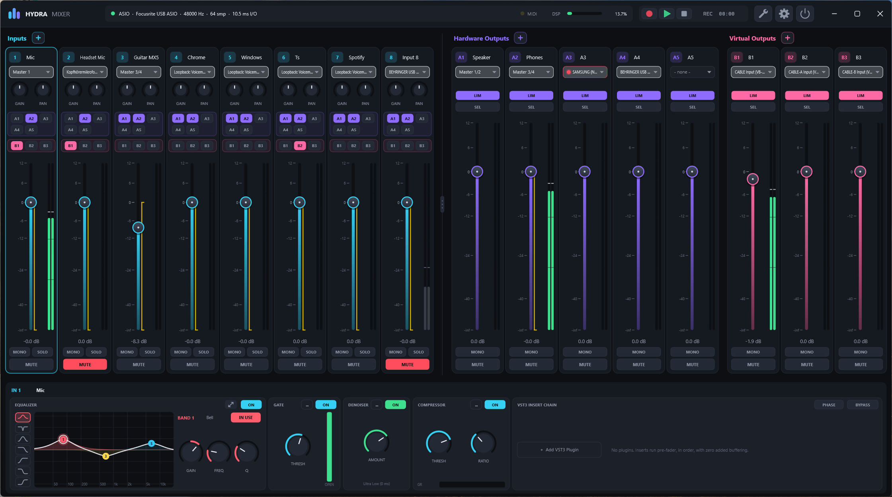

<p align="center">
  
</p>

<h1 align="center">Hydra Mixer</h1>

<p align="center">
  A low-latency virtual audio mixer for Windows. An alternative to Voicemeeter Potato,<br>
  built with C++20 and JUCE (ASIO, WASAPI, VST3, MIDI).
</p>



> **Status: 0.6, early release.** The mixer, the UI and the DSP are complete and covered by offline tests.
> Real-world signal flow (ASIO with real hardware, loopback, drift compensation, VST3 loading, MIDI
> controllers) has seen little testing so far. Expect rough edges and please report what you find.

## Why Hydra?

Hydra is built around three priorities, in this order: **latency, CPU efficiency, stability**.

- The whole mixer runs inside the callback of one master device (ideally ASIO). Its channels go through
  without any extra buffering.
- Every other device (WASAPI devices, loopback, other ASIO interfaces) is attached through a lock-free ring
  buffer and a polyphase resampler with a self-tuning drift controller. Tested with block sizes from 32 to 480
  samples, 44.1 / 48 kHz and ±100 ppm clock drift: zero dropouts in all 96 combinations.
- The audio thread never allocates, never locks and never logs. All DSP (EQ, gate, compressor, limiter) is
  latency-free.
- About 1.6 % of one CPU core while idle with the engine running, about 80 MB of RAM.

## Features

### Channels
- Up to **16 inputs**, **8 hardware outputs (A1–A8)** and **8 virtual outputs (B1–B8)**. Default layout 8 / 5 / 3,
  channels can be added, removed, renamed and reordered (drag & drop, MIDI mappings can follow the channels).
- Input sources: master device channels (ASIO), other ASIO devices at the same time, Windows recording devices
  (Low Latency / Exclusive / Shared), **per-app capture** (e.g. only Spotify or only the game),
  **loopback** of any playback device, and virtual cables.
- Device picker window: connection type → device → channels, with an explanation of latency and exclusivity
  for each type. Status dots on every device chip (offline, dropouts, waiting for app).

### Input strip
Gain → **Denoiser** → **8-band EQ** → **Gate** → **Compressor** → **VST3 chain** → Sync Delay → Mono → Fader / Pan
→ routing to every A and B bus. Plus phase, solo, mute.

- **Denoiser** (RNNoise) in every input, with four latency modes: Ultra Low 0 ms, Low 10 ms, Aligned 20 ms,
  Native HQ 30 ms. Dry/wet mix is latency-aligned. Around 1.8 % of a core per stereo channel.
- **EQ** for inputs and buses: 8 bands, Bell, Notch, Band Pass, Low/High Cut, Low/High Shelf. Interactive curve
  (click to add a band, drag to move), and a large EQ window with a live spectrum analyzer.
- **Gate** with threshold, range, attack, hold, release, sidechain band pass and a **Voice Key**: it only opens
  when the level is above the threshold *and* RNNoise detects speech.
- **Compressor** with input, threshold, ratio, knee, attack, release, makeup, auto gain and a transfer curve
  with gain reduction display.
- **VST3 plugins**: insert chain per input and per bus, drag & drop to reorder. The scan runs safely
  (a crashing plugin is remembered and skipped).

### Buses
- Fader, mute, mono, 8-band EQ, limiter, VST3 chain, any output device.
- **SEL** per bus: the input faders then control the send level of each input into this bus
  (e.g. a separate stream mix). With **monitoring**, the selected bus replaces what you hear on a hardware bus.
- **Sync Delay**: delays the channels of a group to the slowest one, so that devices with different latency
  stay in sync (plus a manual delay per channel, 0–500 ms).

### Recorder
- Records a B bus as WAV (16 / 24 / 32-bit float) and plays WAV, AIFF, FLAC, Ogg and MP3 into any A and B buses.
- Live waveform, seek by clicking, loop, non-destructive trim with "Cut" to write the file.

### Control
- **MIDI Learn** on every control (right click or learn mode): CC, note, pitch bend; modes absolute, toggle,
  momentary, relative; invert, range per mapping, motor fader and LED feedback.
- Pad-grid LED feedback with presets for the **Akai APC mini mk1 / mk2** (mapped on / off / muted channel
  in different colours), fader positions are read from the APC mini at start.
- **Keyboard shortcuts** for every switch, global with Ctrl / Alt / F-keys (also in games),
  mouse buttons (middle, back / forward) as global hotkeys.
- **Scenes**: snapshots of all parameters, recalled by click, MIDI or hotkey, import / export.
- **Global undo / redo** (Ctrl+Z / Ctrl+Y) for all parameters.

### Tools
- **Latency Finder**: the complete signal path of every input → output combination with the latency of each
  stage (device, clock sync buffer, denoiser, plugins, sync delay) as a matrix and as a chart.
- **DSP Load**: CPU load per channel and per stage (denoiser, EQ, gate, compressor, plugins, limiter),
  plus resampling and recorder.
- **Restart Audio Engine** for drivers that silently stop delivering audio.

### App
- Modern dark UI, interface size and text size adjustable (75–200 %).
- System tray, start minimized, start with Windows (scheduled task with high priority, waits for a late ASIO driver).
- Session autosave, automatic backups (up to 40), export / import / restore of all settings.
- **Import from Voicemeeter Potato**: reads a Voicemeeter settings XML and takes over devices, ASIO patches,
  names, routing, EQ, gate, compressor, denoiser and the MIDI mapping.

## Limitation: Hydra has no playback or recording devices of its own

Voicemeeter installs virtual audio devices ("Voicemeeter Input", "Voicemeeter Out B1", ...), so any app can
pick it as its speaker or microphone. **Hydra Mixer does not have such a driver (yet).** A Windows audio driver
only loads with Secure Boot on if it is signed through Microsoft with an EV certificate. Without that it
needs test mode, which breaks games with anti-cheat. So for now:

- Apps can't select "Hydra" as their **playback device**.
- Apps like Discord, OBS or Teams can't select a Hydra B bus as their **microphone**.
- Inputs and B buses imported from Voicemeeter that pointed to a virtual device show up as a
  "Hydra Virtual" placeholder (yellow dot). They carry no audio until you assign a real source.

### Workarounds

**1. Per-app capture (built in, nothing to install).** In an input's device picker choose
**Application** and the app (e.g. `Spotify.exe`). Hydra captures exactly that app's audio, including its child
processes, and reconnects when the app restarts. So you don't hear it twice, set the app's output in
*Windows Settings → System → Sound → Volume mixer* to a device you don't listen to.

**2. Loopback (built in).** Choose **Loopback** and a playback device: Hydra captures everything Windows plays
on it. Useful for a whole device. Loopback goes through the Windows audio engine and adds its latency.

**3. VB-Audio Virtual Cable (free).** Install [VB-CABLE](https://vb-audio.com/Cable/) (more cables with the
A+B and C+D packs).
- *Into Hydra:* the app plays to **CABLE Input**, a Hydra input records **CABLE Output**
  (device picker → **Virtual Cable**).
- *Out of Hydra:* a B bus plays to **CABLE Input**, Discord / OBS use **CABLE Output** as microphone.

**4. Virtual Audio Cable (VAC, paid).** [Virtual Audio Cable](https://vac.muzychenko.net/en/) by Eugene Muzychenko
offers any number of freely named cables ("Line 1", "Line 2", ...). It works the same way as VB-Cable and is
detected automatically.

**5. Voicemeeter's virtual devices.** If Voicemeeter is installed, its playback devices
("Voicemeeter Input", "Voicemeeter AUX Input", "Voicemeeter VAIO3 Input") stay available. Let apps play to one
of them and capture it in Hydra with **Loopback**. Close Voicemeeter itself, so it doesn't hold the ASIO driver.
Voicemeeter's devices only pass audio between each other while Voicemeeter runs, so to send a B bus to
Discord / OBS use one of the cables above.

*Settings → Virtual Cables* lists all detected cables and has **Auto-assign cables**, which gives every
"Hydra Virtual" placeholder from a Voicemeeter import the next free cable.

## Installation

1. Download `HydraMixer-0.6-win64.zip` from the [Releases](https://github.com/TicT4x/Hydra-Mixer/releases) page.
2. Unzip it anywhere and start `Hydra Mixer.exe`. No installer, no runtime needed.
3. Open the settings (gear icon) → **Audio Engine** and choose the master device. ASIO gives the lowest latency.

Requirements: Windows 10 / 11, 64-bit, a CPU with AVX2.

Settings, backups and the log are stored in `%APPDATA%\HydraMixer\`.

## Building from source

Requires Visual Studio 2026 Build Tools (MSVC, C++ workload), CMake ≥ 3.25 and Ninja.

```powershell
git clone --recursive https://github.com/TicT4x/Hydra-Mixer.git
cd Hydra-Mixer
.\build.ps1                # Release
.\build.ps1 -Config Debug
```

- App: `build\Release\HydraMixer_artefacts\Release\Hydra Mixer.exe`
- Tests: `build\Release\HydraTests_artefacts\Release\HydraTests.exe`

## License

Copyright (C) 2026 Til. Hydra Mixer is free software under the
[GNU Affero General Public License v3.0](LICENSE).

## Third-party code

- [JUCE 8](https://juce.com) (`external/JUCE`, submodule, AGPLv3): audio, UI, ASIO, VST3 hosting.
- [RNNoise 0.2](https://github.com/xiph/rnnoise) (`external/rnnoise`, BSD license): noise suppression,
  patched to expose its band gains.

ASIO is a trademark of Steinberg Media Technologies GmbH. Voicemeeter, VB-CABLE and VB-Audio are trademarks
of VB-Audio Software. Hydra Mixer is not affiliated with them.
